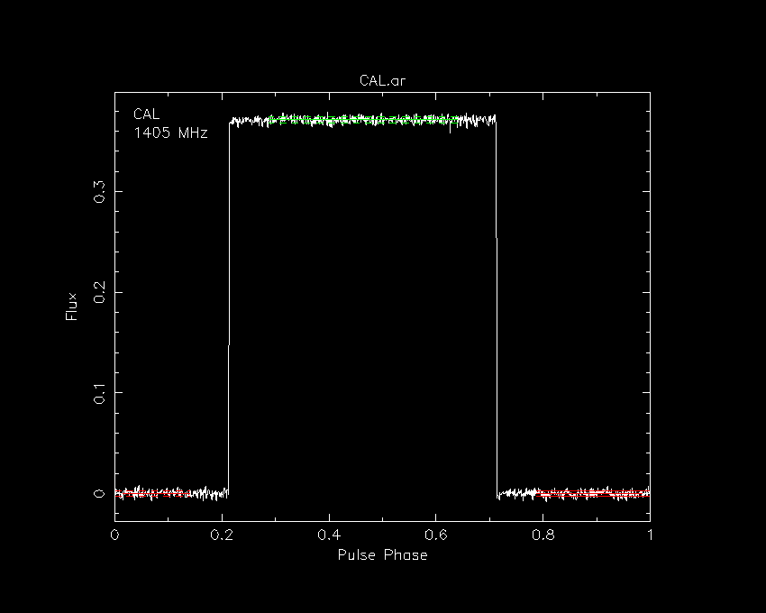
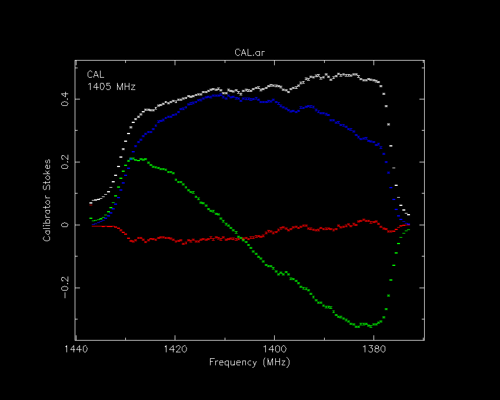
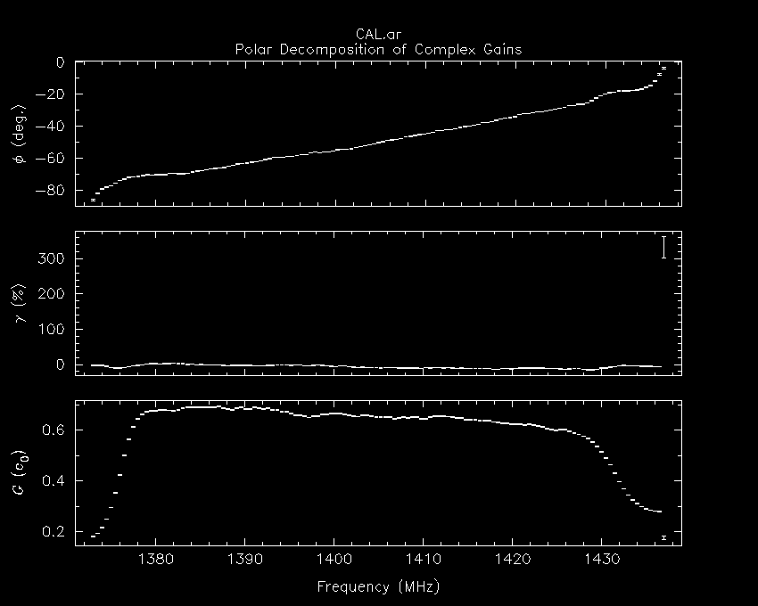
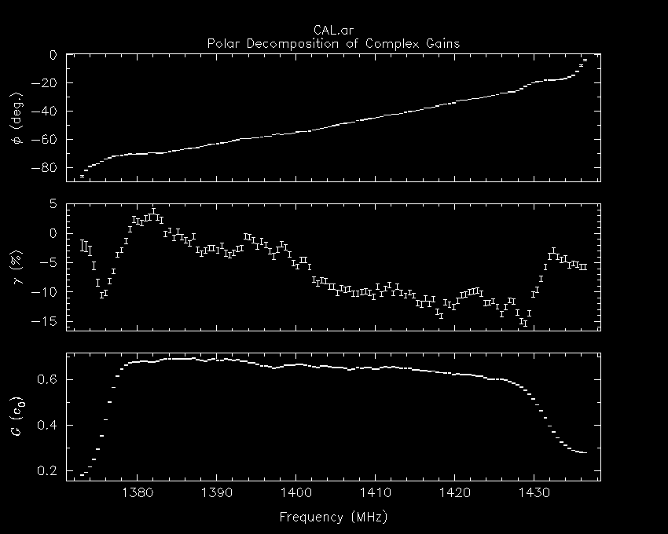
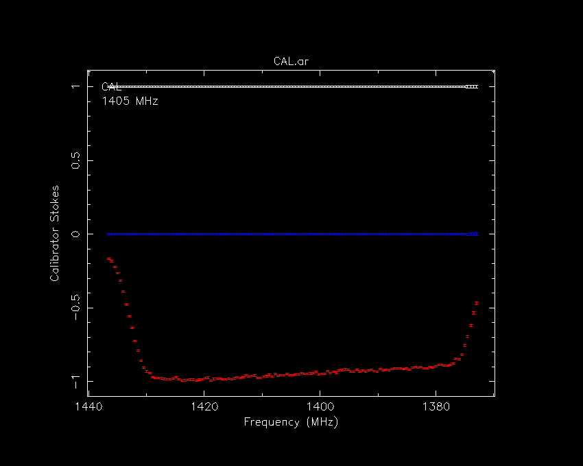

# Viewing Calibrator Data

Assuming that the folded CAL observation is saved in the file,
CAL.ar, both the data and the calibrator solution that
is derived from them can be viewed with commands like the following:

---

Plot the total intensity, integrated over all frequency-channels and
sub-integrations

```
psrplot -pD -jFTp CAL.ar
```


The solid green line should be centred on the mean of the on-pulse and
the solid red line should be centred on the mean of the off-pulse.
The dashed lines are spaced one standard deviation on either side of
the solid line.

---

Plot the on-pulse Stokes parameters as a function of frequency channel

```
pacv -n csu CAL.ar
```



---

Plot the single-axis calibrator solution derived from this observation
as a function of frequency channel

```
pacv CAL.ar
```


This last image indicates that channel 0 (the data are lower sideband)
yields an anomalous solution. It can be removed from the plot with
the `-c` command line option; e.g.

```
pacv -c 0 CAL.ar
```



---

Finally, plot the on-pulse Stokes parameters as a function of frequency
channel, after application of calibrator to itself.

```
pacv -n csc -c 0 CAL.ar
```


The white data points represent Stokes I (total intensity); the
gain scale has been calibrated such that the CAL has a total flux of unity.
The red data points represent Stokes Q; differential gain and phase
have been applied such that Stokes U and V (green and blue) are zero.
The negative values of Stokes Q are indicative of the symmetry angle
of the receptor basis, which is set to -90 degrees in this example
file (as can be queried with `psredit -c rcvr:sa CAL.ar`).
Stokes Q dips toward zero at the edges of the band, indicating
instrumental depolarization most likely due to two-bit quantization
effects.
