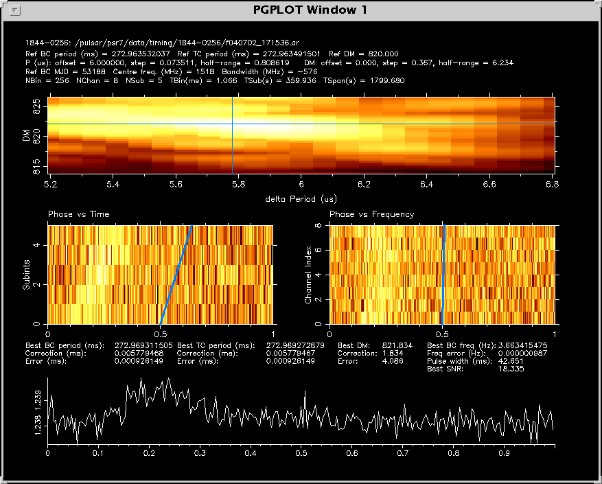
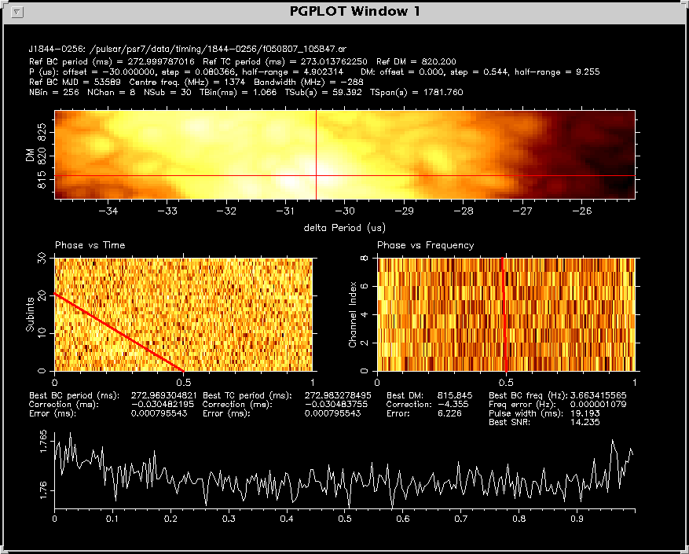
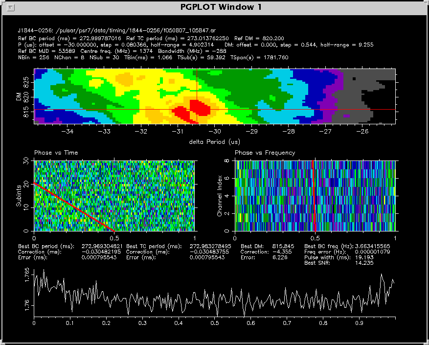

# pdmp

## 1.0 Purpose

A PSRCHIVE tool that searches through a specified range of Barycentric
Period and Dispersion Measure to find values giving the highest Signal-to-Noise ratio.

## 2.0 Usage

```
Usage: pdmp [options] file1 [file2 ...]

Preprocessing options:
 -dm  <dm>                      Manually set the dm
 -do  <dm offset>               DM offset in pc/cm^3      (default=0)
 -dr  <dm half-range>           DM half-range in pc/cm^3  (default=natural)
 -ds  <dm step>                 DM step in pc/cm^3        (default=natural)
 -f , --force                   Force the program to compute without prompting
 -mc, --maxchannels <max chan>  Archive frequency channels will be 
                                partially scrunched to <= this maximum
                                before computing 
 -ms, --maxsubints <max subint> Archive subints will be 
                                partially scrunched to <= this maximum
                                before computing
 -p   <period>                  Manually set the period in (ms)
 -po  <period offset>           Period offset in us       (default=0)
 -pr  <period half-range>       Period half-range in us   (default=natural)
 -ps  <period step>             Period step in us         (default=natural)
 -s   <profile file>            Use <profile file> as a standard profile to
                                compare with

Selection & configuration options:
 -g <dev>   Manually specify a plot device

Other plotting options: 
 -c <index>  Select a colour map for PGIMAG style plots
             The available indices are:
               0 -> Greyscale
               1 -> Inverse Greyscale
               2 -> Heat (default)
               3 -> Cold
               4 -> Plasma
               5 -> Forest
               6 -> Alien Glow

 -lc <index> Select the colour index for the line of best fit
             The available indices are:
               0 -> Black
               1 -> White
               2 -> Red (default)
               3 -> Lime green
               4 -> Navy blue
               5 -> Cyan
               6 -> Pink
               7 -> Yellow
               8 -> Orange
               9 -> Green
               10 -> Aqua green
               11 -> Blue
               12 -> Purple
               13 -> Pinkish red
               14 -> Dark grey
               15 -> Light grey

Utility options:
 -h         Display this useful help page (most useful options)
 --help     Display a complete list of help options
 -v         Verbose output
 -S         Silent mode. Reduce text written to standard output.
```

#### Output

Once the search is complete, it will display four plots along with a number of
values, including the original pulsar parameter values for:

* (Barycentric and Topocentric) period
* Dispersion measure
* Barycentric MJD
* Bandwidth
* Centre frequency
* Number of sub-integrations
* Number of phase bins
* Number of frequency channels
* Time span per phase bin
* Time span per sub integration
* Total observation time

The period and dispersion measure search parameters displayed on output include:

* Offset: The search starts at the reference period/dm + the period/dm offset
* Half-Range: The search will trial period/dm values within: reference period/dm + offset +/- period/dm half range
* Step: The trial values will be incremented/decremented by period/dm step from the reference period/dm + offset.

The results are then displayed on output, including:

* Best barycentric and topocentric period (ms)
  + Period correction (ms)
  + Error in the correction (ms)
* Best dispersion measure
  + Dispersion measure correction
  + Error in this correction
* Best barycentric frequency (Hz)
  + Error (Hz)
* Profile pulse width (ms) after corrections
* Best signal-to-noise ratio value using the best period and dispersion measure

Finally, four plots will be displayed including:

* A colour map of delta Period (us) vs. delta DM vs. signal-to-noise ratio (colour). Cross hairs indicate the highest signal to noise ratio value.
* A colour map of phase vs. subints
* A colour map of phase vs. channel index
* A time, frequency and polarisation scrunched pulse profile with the new best period and dispersion measure

## 3.0 Examples:

Uses the `-lc` option to make the lines of best fit and cross hairs blue and `-po` to set the period offset to 6 microseconds:
`pdmp -lc 11 -po 6 /pulsar/psr7/data/timing/1844-0256/f040702_171536.ar`

Set the period offset back by 30 microseconds from the reference period:
`pdmp -po -30 /pulsar/psr7/data/timing/1844-0256/f050807_105847.ar`

Change the colour index to "Alien Glow" and perform the same query as above. This colour scheme can help with identifying the period/dm drift along the phase:
`pdmp -c 6 -po -30 /pulsar/psr7/data/timing/1844-0256/f050807_105847.ar`

To put the output in postscript format, you can use the `-g /ps` flag:
`pdmp -po -30 -g /ps /pulsar/psr7/data/timing/1844-0256/f050807_105847.ar`
To use a standard profile to compare against, you can use the `-s file` option:
`pdmp -po -30 -s std_prof.FTp -g /ps /pulsar/psr7/data/timing/1844-0256/f050807_105847.ar`

## 4.0 Known bugs and features that require implementation

* None at this time.

---

Last Updated 14/3/2006 by Albert Teoh
