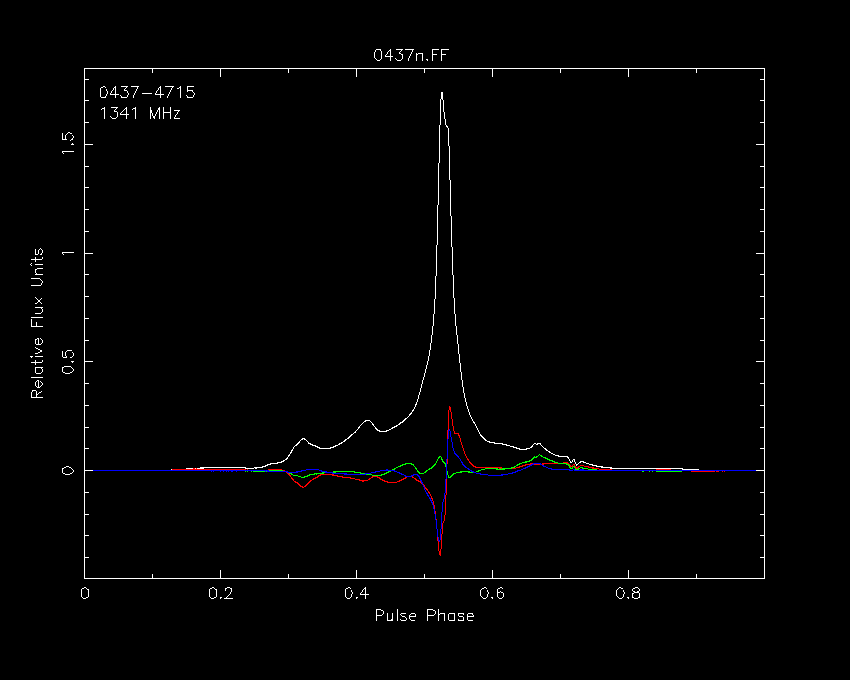
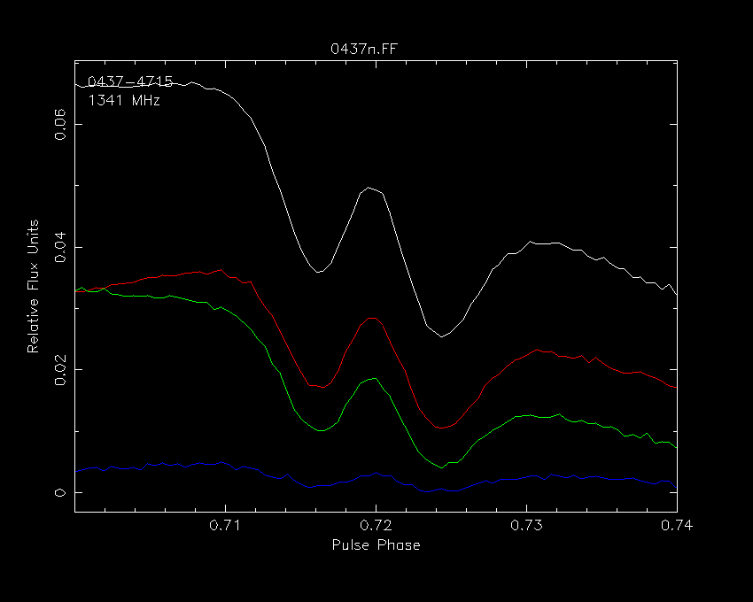
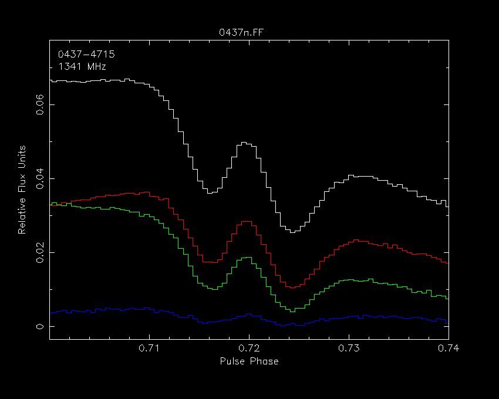
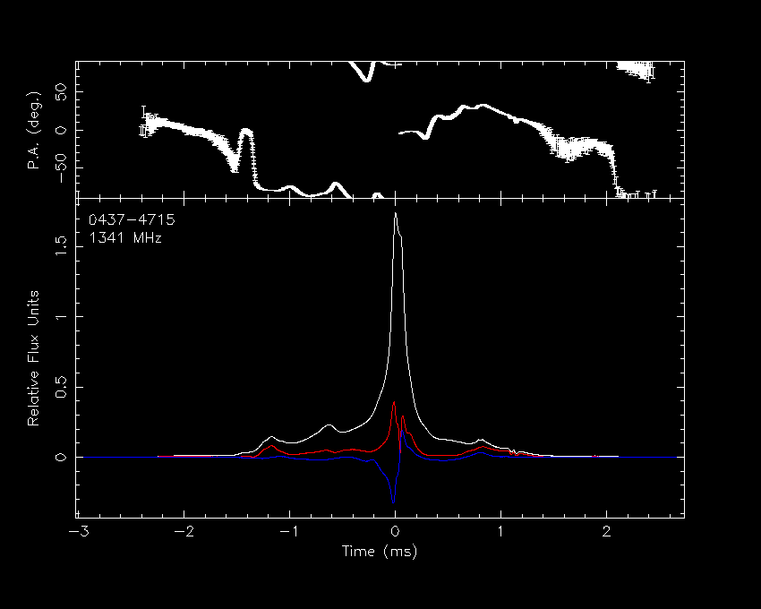
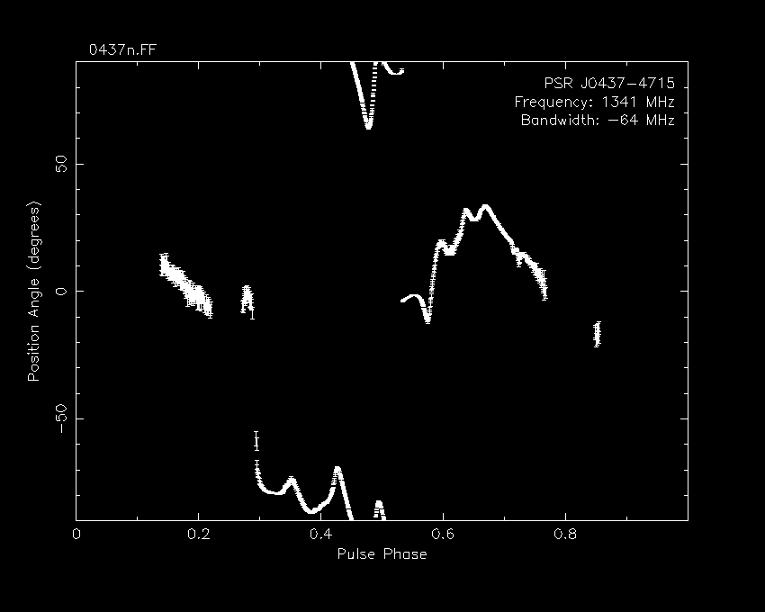

# PSRCHIVE documentation: psrplot customization

## PSRCHIVE documentation: **psrplot** customization

**psrplot** can be customized using any combination of

* [command line arguments](customization.shtml.html#command_line),* [style files](customization.shtml.html#style_file), and* [option sets](customization.shtml.html#option_sets).

### Customization on the Command Line

Customization options may be specified as a comma-separated list on the
command line, using one or more options of the form

```
-c option1[,option2,...]
```

For example, start with plotting the Stokes parameters in a single
frame with QUV = RGB:

```
psrplot -p stokes 0437n.FF
```



To zoom in on a range in pulse phase:

```
psrplot -p stokes -c 'x:range=(.7,.74)' 0437n.FF
```

***Note:** the single quotes are necessary to prevent shell
expansion of the round brackets*



To extend the y-axis a bit so that the label is not obscured by the
plot, and plot using the histogram style:

```
psrplot -p stokes -c 'x:range=(.7,.74),y:range=(0,1.1),hist=1' 0437n.FF
```

***Note:** ranges are specified in normalized units*



To plot the Stokes vector in cylindrical coordinates, with units of
milliseconds on the x-axis, the origin at the pulse peak, and no
filename over the frame:

```
psrplot -p Scyl -c x:unit=ms,x:origin=-.525,pa:above:c=" " 0437n.FF
```

***Note:** the label*, above:c, *belongs to the plot
named* pa, a sub-plot of Scyl.



### Customization using Style Files

It can become cumbersome to repeatedly enter long lists of
customization options on the command line; there is the option to
specify these options using style files. For example, suppose that
you don't like the pulsar name and frequency in the top-left corner of
your plots, and would rather that the source name, frequency, and
bandwidth appear in the top-right corner. Also, suppose you want the
filename to the left of the frame instead of over the centre. You
could write the following style file:

```
above:c=unset
above:l=$file
below:l=unset
below:r=PSR J$name\nFrequency: $freq MHz\nBandwidth: $bw MHz
```

Note that variable names from the `Pulsar::Archive`
class text interface may be specified by preceding the variable name with
a dollar sign ($). The variable names are the same as those understood
by **psredit**; for a complete listing, run:

```
psredit -H
```

Continuing with the example, name the style file style.txt and run

```
psrplot -p pa -s style.txt 0437n.FF -c cut=10.0
```

***Note:** each \n in the label translates into a new
line inside the frame.*



Style files can also be used to create and customize multiple plots,
as described in
[multiple plot style files](viewport.shtml.html#style).

#### Embedded pre-processing commands

It is also possible to embed data pre-processing commands in a style
file using the `exec` command; for example,

```
exec dedisperse

#################################################
# create a phase-vs-time plot
plot time

# plot a copy of the data integrated over all frequency channels
exec fscrunch

#################################################
# create a phase-vs-frequency plot
plot freq

# plot a copy of the data integrated over all sub-integrations
exec tscrunch
```

Note that

* plot *<name>* creates a new plot* exec commands encountered before any plot is created
    will be applied to the data input to all plots* exec commands encountered after a plot is created
      will be applied to the data input only to the last created plot.

### Customization Option Sets

Customization option sets provide shortcuts to commonly used sets of
plot attributes. Option sets are used by setting the `set`
attribute to the name of the desired option set, e.g.

```
-c set=name
```

The following option sets are available:

* `pub` for publication quality plots; `set=pub`
  is equivalent to

  ```
  ch=1.5
  cf=2
  lw=3
  above:l=""
  above:c=""
  above:r=""
  ```

  * `blank` removes all text labels; `set=blank`
    is equivalent to

    ```
    x:opt=BCST
    y:opt=BCST
    x:lab=""
    y:lab=""
    above:l=""
    above:c=""
    above:r=""
    below:l=""
    below:c=""
    below:r=""
    ```

Copyright © 2006-2019 Willem van Straten
Licensed under the Academic Free License version 2.1
