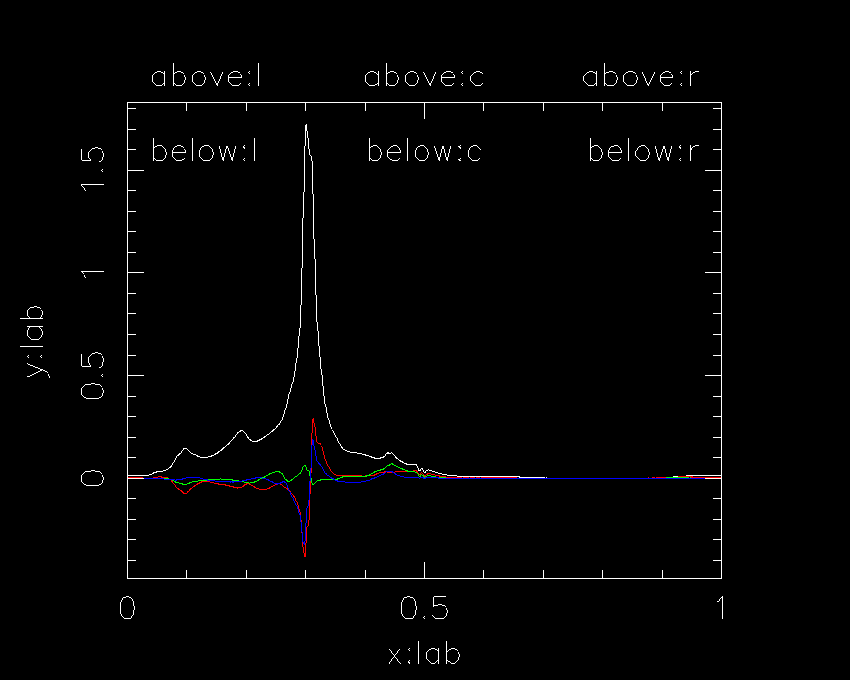

# psrplot** labels

The labels on
**psrplot** plots may be set using

* [label names](label.shtml.html#name),
* [multiple lines](label.shtml.html#multiple),
* [variable subsitution](label.shtml.html#variable).

### Label names

There are a total of eight label positions on each panel of a
**psrplot** plot:

* `x:lab` - label on x-axis
* `y:lab` - label on y-axis
* `above:l` - label above top of viewport (left)
* `above:c` - label above top of viewport (centre)
* `above:r` - label above top of viewport (right)
* `below:l` - label below top of viewport (left)
* `below:c` - label below top of viewport (centre)
* `below:r` - label below top of viewport (right)



For example:

```
psrplot -p stokes -c above:l="Template profile" 0437n.FF
```

### Multiple lines

Multiple lines may be printed above and below the top of the frame.
Each line in a plot label is separated by a C-style newline
`\n`, as in the following example:

```
psrplot -p stokes -c below:l="PSR J0437-4715\nStokes parameters" 0437n.FF
```

### Variable substitution and mathematical expressions

Plot labels may also include variable names and mathematical
expressions that are interpreted before plotting using the syntax
described [here](../guide/design/evaluation.md).
