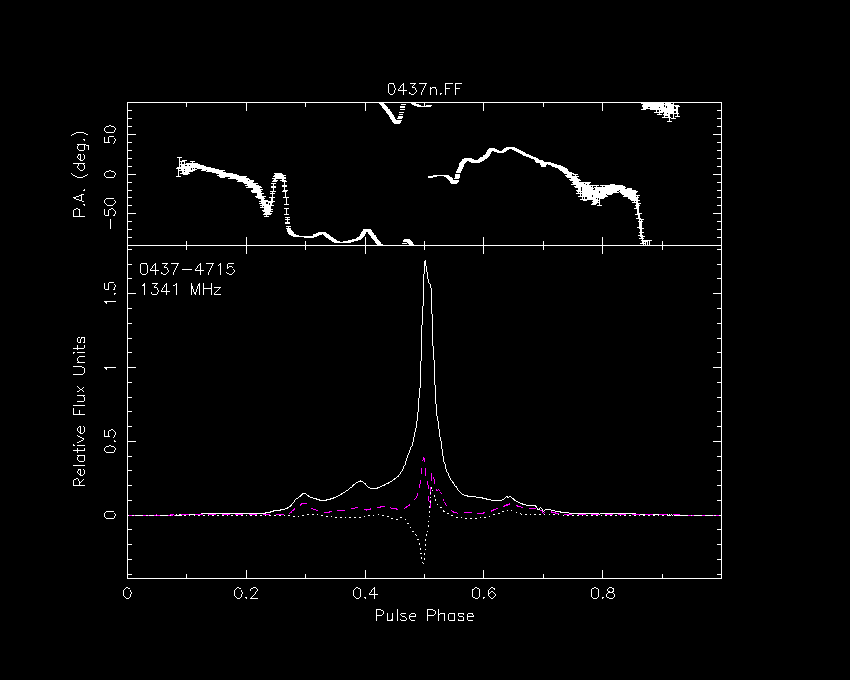

# psrplot** pen attributes

The attributes of the pen used to draw
**psrplot** plots may be set, including

```{contents}
:depth: 1
:local:
```

## Character font and height

The character font and height may be set via the `cf` and
`ch` attributes. The default value for each of these is 1 (one).
The character font may be set to any integer supported by the[PGSCF](http://www.astro.caltech.edu/~tjp/pgplot/subroutines.html#PGSCF) subroutine. The character height may be set to any
floating point value, as described in the
[PGSCH](http://www.astro.caltech.edu/~tjp/pgplot/subroutines.html#PGSCH) documentation.

## Line width and style

The line width may be set via the `lw` attribute.
The default value is 1 (one), and the line width may be set to any integer
up to 201, as described in the[PGSLW](http://www.astro.caltech.edu/~tjp/pgplot/subroutines.html#PGSLW) documentation.

Certain plots have other attributes, such as the line style and colour.
For example, the "stokes" plot has colour index `ci` and
line style `ls` attributes, which correspond to the PGPLOT
[PGSCI](http://www.astro.caltech.edu/~tjp/pgplot/subroutines.html#PGSCI) and
[PGSLS](http://www.astro.caltech.edu/~tjp/pgplot/subroutines.html#PGSLS) subroutines. Each attribute is a string of numbers, and the
Nth element of the string defines the colour index or line
style to be applied to the Nth plotted value.

For example, to plot linear polarization with a dashed, magenta line and
circular polarization with a dotted, white line

```
psrplot -p Scyl -c flux:ci=161,flux:ls=124 0437n.FF
```


