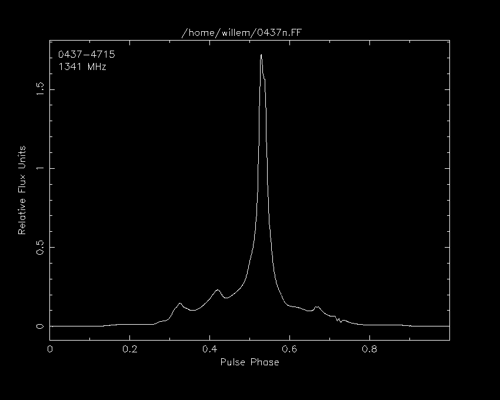
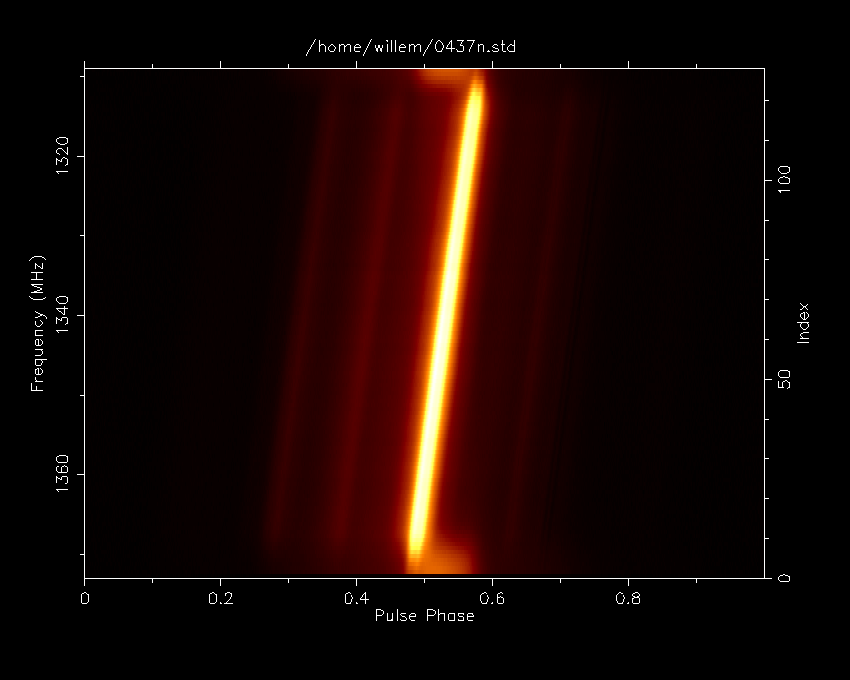
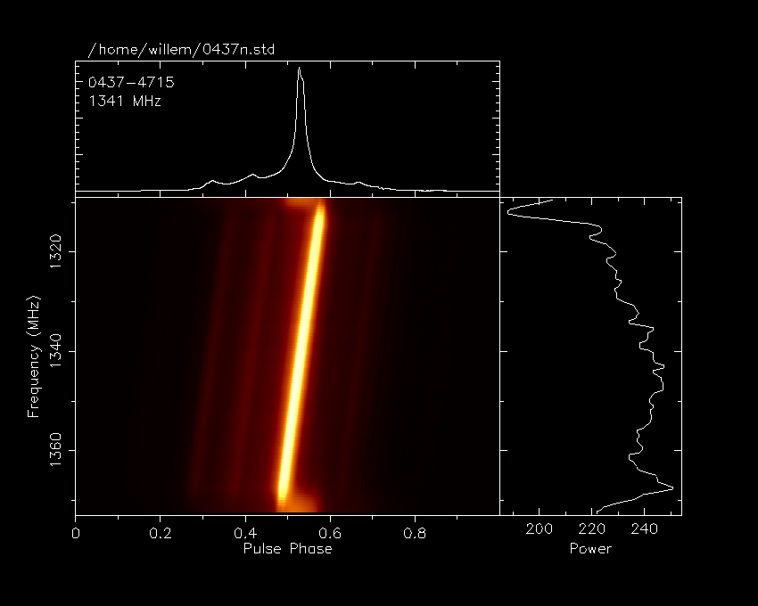
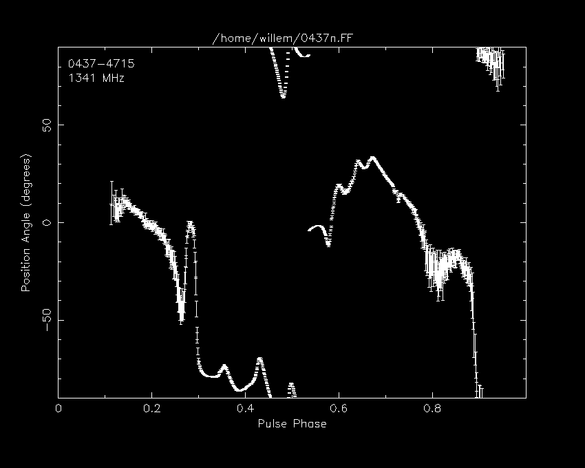
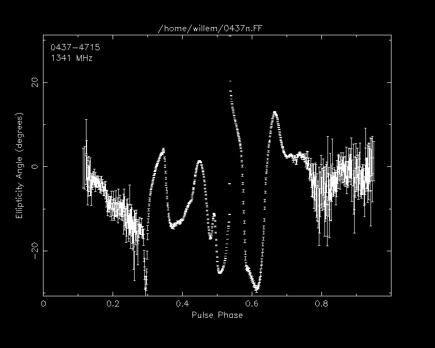
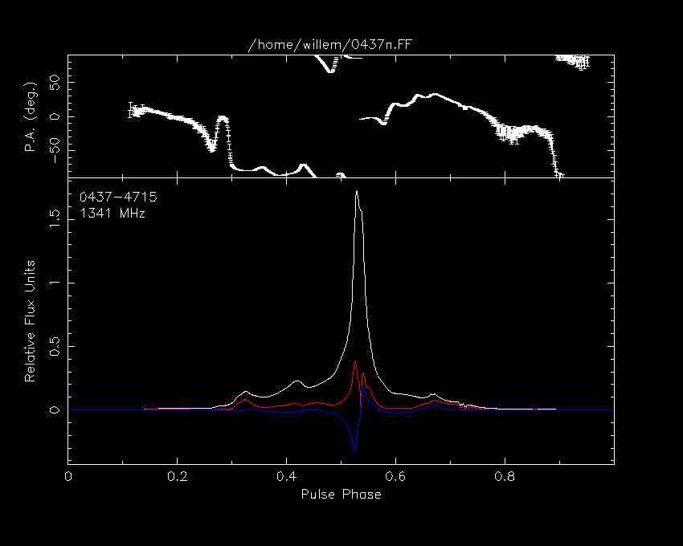
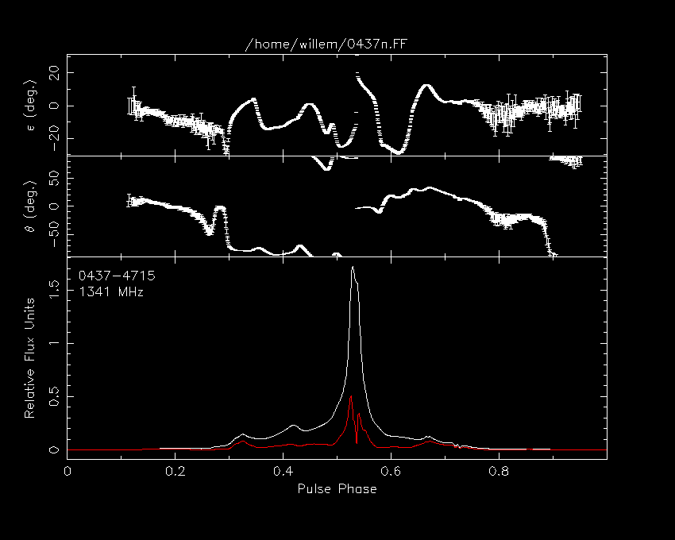
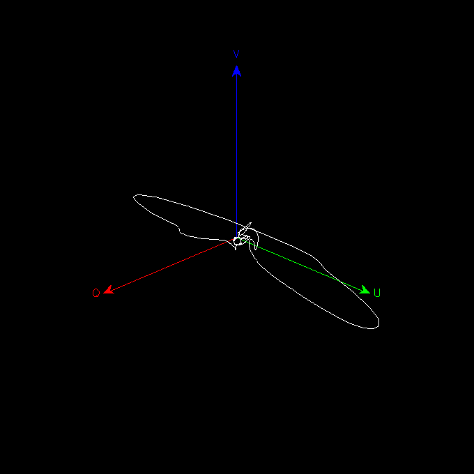
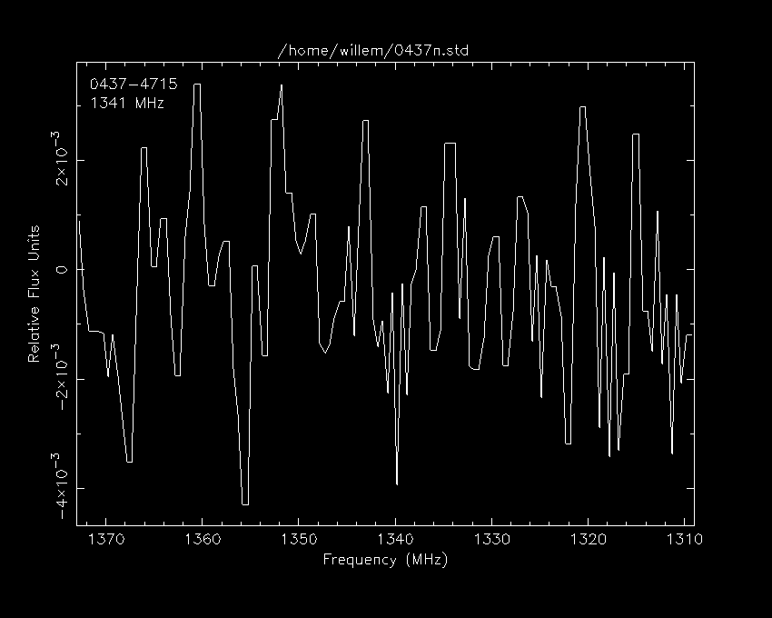

# Available plots

```
psrplot -p flux
```



---

```
psrplot -p stokes
```


---

```
psrplot -p freq
```



---

```
psrplot -p freq+
```



---

```
psrplot -p pa
```



---

```
psrplot -p ell
```



---

```
psrplot -p Scyl
```



---

```
psrplot -p Ssph
```



---

```
psrplot -p p3d
```



---

```
psrplot -p psd
```



