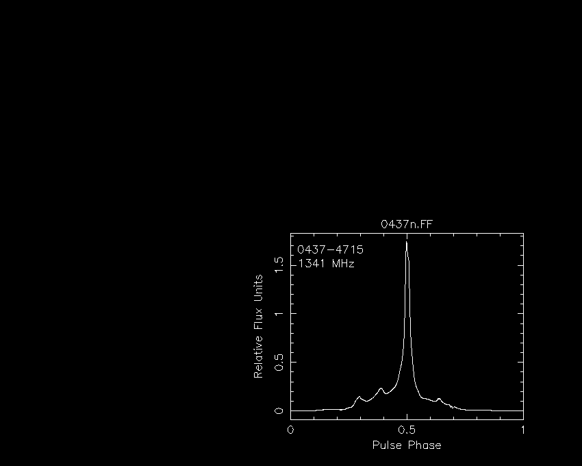
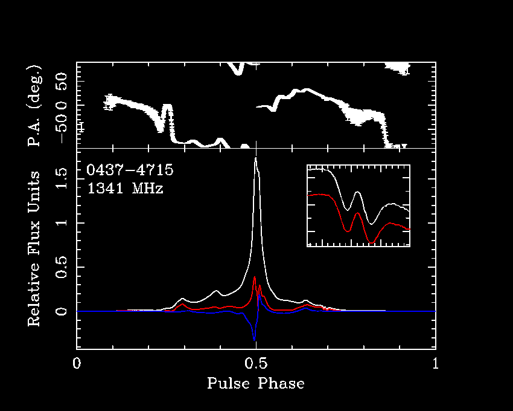
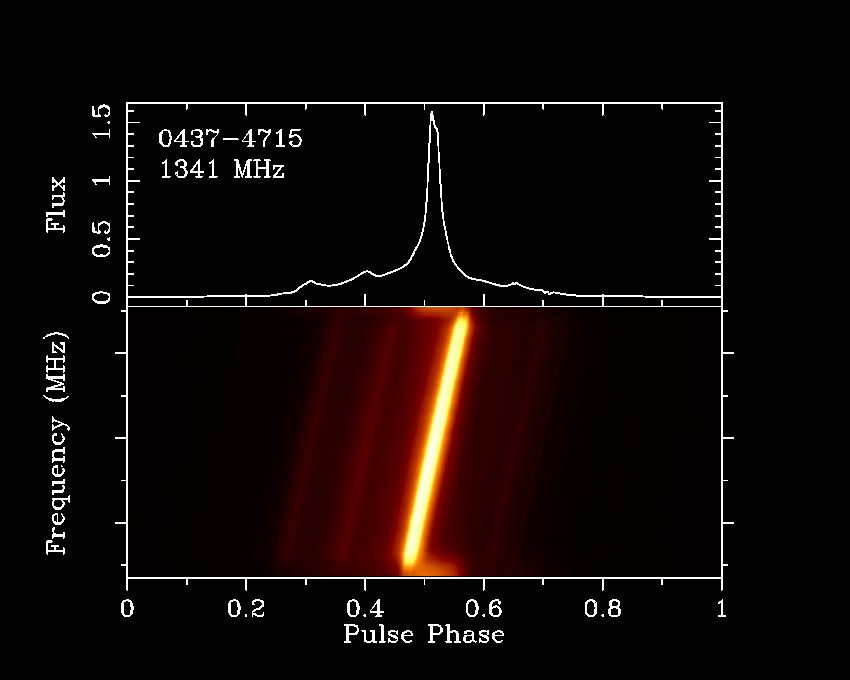

# psrplot** layout

The layout of any
**psrplot** plot may be customized, including

* [viewport position and size](viewport.shtml.html#position),
* [overlaying multiple plots](viewport.shtml.html#overlay), and
* [multiple plot style files](viewport.shtml.html#style).

### Viewport position and size

The position and size of the plot window (viewport) are set using the
`x:view` and `y:view` customization options. These
are specified in normalized device coordinates, and the default value
for each is `(0.15, 0.85)`. For example,

```
psrplot -p flux -c 'x:view=(0.5,0.9),y:view=(0.1,0.5)' 0437n.FF
```



### Overlaying multiple plots

By default, each selected plot is printed on a clean page. However,
it is also possible to overlay multiple plots on a single page with
the `-O` command line option. When plotting multiple plots,
it may also be necessary to send customization options to a specific
plot. This is done by prefixing a plot index between two colons to
the customization options and/or style file name, as in

```
-c :index:option1[,option2,...]
```

For example,

```
psrplot -O -p Scyl -p stokes -c set=pub \
     -c ':1:x:view=(0.6,0.8),y:view=(0.4,0.6),x:range=(.675,.71)' \
     -c ':1:val=IL,set=blank' 0437n.FF
```



The same syntax can be used to specify plot-specific preprocessing
operations; e.g.

```
psrplot -N 2x1 -p time -p freq -j dedisperse -j :0:fscrunch -j :1:tscrunch
```

will plot a phase-versus-time plot of a copy of the input data that
have been dedispersed and integrated over all frequency channels and a
phase-versus-frequency plot of a copy of the input data that have been
dedispersed and integrated over all sub-integrations.### Multiple plot style files

To avoid long cryptic command lines, it is also possible to create
and customize multiple plots using style files. For example, save
the following style file as style.txt

```
# publication quality 
set=pub

#################################################
# create a phase-vs-frequency plot
plot freq

# set the viewport vertical axis
y:view=0.15:0.55

# don't plot Index on right-hand y-axis
y:alt=0

# but do plot the frequency axis
y:opt=BCITS

#################################################
# create a phase-vs-flux plot
plot flux

# set the viewport vertical axis
y:view=0.55:0.85

# remove label on x axis
x:lab=

# remove numerical labels on x axis
x:opt=BCTS

# plot fscrunched total
chan=I
```

and run

```
psrplot -O -s style.txt 0437n.std
```

yielding

Note that

* plot *<name>* creates a new plot
* key=value commands encountered before any plot is created
  apply to all plots
* key=value commands encountered after a plot is created
  apply only to the last created plot.

Copyright © 2006-2019 Willem van Straten
Licensed under the Academic Free License version 2.1
