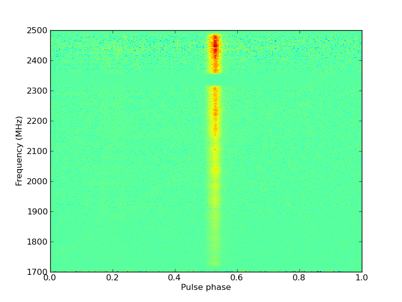

# PSRCHIVE Python Interface

### Introduction

This is a draft user's manual for the PSRCHIVE
Python interface.

Suggestions and contributions are welcome!

### Prerequisites

In addition to the standard PSRCHIVE
dependencies, the Python interface requires a small number of additional
external programs or libraries. The minimum requirements are:

* [Python](http://www.python.org/), version 2.x or 3.x,
  including the development headers ("python-dev" or similar package).
* [SWIG](http://www.swig.org/), any version, is needed to generate the
  Python/C++ interface code.
* [NumPy](http://numpy.scipy.org/), version 1.x, the Python library
  for handling N-dimensional data arrays. The PSRCHIVE Python bindings are incompatible with NumPy 2.x.

These are available in all standard Linux distributions, and should
typically be installed by your operating system's package manager.

Not strictly required, but very useful are:

* [SciPy](http://www.scipy.org/), a large set of very
  useful routines for scientific computing in Python.
* [matplotlib](http://matplotlib.sourceforge.net/) is
  a widely used Python plotting library.
* [IPython](http://ipython.org/) enhances the standard
  Python interpreter for interactive use (e.g., tab completion, help
  screens, etc).

### Installation

It is easiest install the PSRCHIVE Python
interface using `conda`, as described at <https://anaconda.org/conda-forge/psrchive>.

The Python interface comes with the standard PSRCHIVE distribution. It
requires PSRCHIVE shared libraries to be built.
The Python interface will be compiled and installed automatically when
the `--enable-shared` option is given to `configure`,
and the necessary external software (see above) is found. Refer to the
[standard installation instructions](../download.md) for
more information.

It may be necessary to update the `PYTHONPATH` environment
variable so that python can find the installed files; e.g.

```
export PYTHONPATH=$PSRHOME/lib/python2.7/site-packages:$PYTHONPATH
```

If the installation was successful, running `import psrchive`
in Python should not return an error.

### Usage

The basic way the interface works is to provide Python programs with
access to the C++ classes that PSRCHIVE is built
on. Currently, only the core PSRCHIVE classes -
Archive, Integration, and Profile - are represented in Python. However,
these three classes alone provide access to a very large fraction of
PSRCHIVE's functionality. Detailed documentation
about the class methods can be found in the [C++ Library Reference Manual](../classes/psrchive.md).

In addition to the C++ methods, each of these classes has some extra
Python-specific functionality added to it:

#### Archive

An Archive object represents a single data file, and contains a
collection of Integration objects, also known as subintegrations. An
Archive can be loaded into python using the `Archive_load`
function, as demonstrated in the following IPython session:

```
In [1]: import psrchive

In [2]: arch = psrchive.Archive_load('file.fits')

In [3]: arch.get_source()
Out[3]: '1744-1134'
```

The `get_data()` method is an extra Python function that
returns the raw data from the file as a NumPy array:

```
In [4]: data = arch.get_data()

In [5]: data.shape
Out[5]: (10, 4, 2048, 256)
```

The dimensions of the data array are subintegration, polarization,
channel, and profile bin. **Important note**: The `get_data()`
function returns a *copy* of the Archive data. So changes made to
the returned array will not be reflected in the Archive, and vice-versa.

Integrations within an Archive can be accessed in Python by indexing the
Archive object. So the following two lines are equivalent:

```
In [6]: subint = arch.get_Integration(0)

In [7]: subint = arch[0]
```

#### Integration

An Integration object represents a collection of pulse profiles recorded
simultaneously, typically from a number of frequency channels and
polarization states (Stokes parameters):

```
In [8]: subint.get_duration()
Out[8]: 60.230205439999999

In [9]: subint.get_nchan()
Out[9]: 2048
```

The existing `baseline_stats()` and `cal_levels()`
methods have been modified for Python to return tuples of arrays, for
example:

```
In [10]: (b_mean, b_var) = subint.baseline_stats()

In [11]: b_mean.shape
Out[11]: (4, 2048)
```

An Integration object contains a number of pulse profiles that can be
accessed via `get_Profile(ipol,ichan)`:

```
In [12]: prof = subint.get_Profile(0,0)
```

#### Profile

A Profile object represents a single pulse profile. The
`get_amps()` method returns the profile data as a NumPy array:

```
In [13]: pdata = prof.get_amps()

In [14]: pdata.shape
Out[14]: (256,)
```

In contrast to the `arch.get_data()` example above, the pdata
array here points into the actual C++ data structure. So changes made
to the array values *will* be reflected in the underlying Profile
object.

The profile data values can also be read and/or altered by indexing the
Profile object directly, for example:

```
In [15]: pdata[16]
Out[15]: 91.366058

In [16]: prof[16]
Out[16]: 91.366058349609375

In [17]: prof[16] = 500.0

In [18]: pdata[16]
Out[18]: 500.0
```

#### MJD

The [MJD class](../classes/Util/classMJD.md) is also now
available in Python to deal with high-precision date/time values.
Return values for date/time functions such as
`Integration.get_epoch()` were previously converted to doubles
for convenience. To reproduce the old behavior and get a
double-precision MJD value, use the `MJD.in_days()` method, for
example:

```
mjd_dbl = arch.get_Integration(0).get_start_time().in_days()
```

#### Generating TOAs with ArrivalTime

The [ArrivalTime
class](../classes/psrchive/classPulsar_1_1ArrivalTime.md) can be used to generate pulse times of arrival (TOAs) directly in
Python, as an alternative to using the command-line utility [pat](pat.md). Here is an example illustrating the basic usage:

```
import psrchive

arrtim = psrchive.ArrivalTime()
arrtim.set_shift_estimator('PGS')        # Set algorithm (see 'pat -A' help)
arrtim.set_format('Tempo2')              # set TOA format
arrtim.set_format_flags('IPTA')          # set some TOA flags
arrtim.set_attributes(['chan','subint']) # More TOA flags

# Load template profile
std = psrchive.Archive_load('J1713+0747.Rcvr1_2.GUPPI.9y.x.sum.sm')
std.pscrunch()
arrtim.set_standard(std)

# Load observation profiles
obs = psrchive.Archive_load('guppi_55616_J1713+0747_0009.12y.x.ff')
obs.pscrunch()
arrtim.set_observation(obs)

# Result is a tuple of TOA strings:
toas = arrtim.get_toas()
```

### Simple Example

In this example, we recreate the helpful "`pav -GTdp`" plot
using python, and demonstrate some common psrchive functionality:

```
#! /usr/bin/env python
import pylab
import psrchive
arch = psrchive.Archive_load('1744_0001_0001.fits')
arch.bscrunch_to_nbin(256)
arch.dedisperse()
arch.fscrunch_to_nchan(512)
arch.remove_baseline()
arch.convert_state('Stokes')
data = arch.get_data()
freq_lo = arch.get_centre_frequency() - arch.get_bandwidth()/2.0
freq_hi = arch.get_centre_frequency() + arch.get_bandwidth()/2.0
pylab.imshow(data[:,0,:,:].mean(0),extent=(0,1,freq_lo,freq_hi))
pylab.xlabel('Pulse phase')
pylab.ylabel('Frequency (MHz)')
pylab.savefig('python_plot_example.png')
```

This results in the following plot:


### More Examples

* Example 1 (TBD)
* Example 2 (TBD)

Copyright © 2006-2019 Paul Demorest
Licensed under the Academic Free License version 2.1
